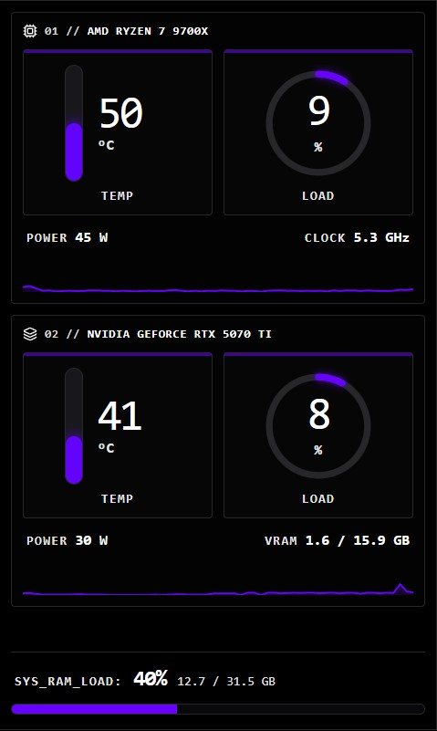
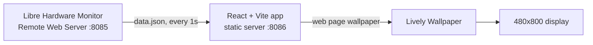

# PC Telemetry

A minimalist, high-contrast hardware dashboard for a small 480x800 portrait screen inside my PC. It shows live CPU, GPU and RAM stats and runs as a wallpaper on that screen.



## Features

- CPU temperature and load, GPU temperature and load, and RAM usage, refreshed every second
- Power, clock and VRAM stats, and 60-second load sparklines.
- Temperature bars shift to red as the hardware heats up
- Hardware names are read from the data, so nothing is hardcoded for one machine
- Shows `--` and an `LHM OFFLINE` label when data is unavailable, instead of stale or zero values
- Runs as a static build with very low CPU and memory overhead
- Unit-tested sensor parser

## Hardware setup

The display is a 480x800 HDMI screen left over from Raspberry Pi and IoT projects. My CPU’s integrated GPU was unused, so I connected the screen to the motherboard’s HDMI port. Windows sees it as a second monitor, and Lively Wallpaper shows the dashboard on that screen only.

## How it works



| Part | Role |
|------|------|
| **Frontend** | React, TypeScript, Vite, Tailwind CSS v4, Lucide React. Served as a static build on port **8086**. |
| **Data provider** | [Libre Hardware Monitor](https://github.com/LibreHardwareMonitor/LibreHardwareMonitor) with the Remote Web Server enabled, on port **8085**. |
| **Renderer** | [Lively Wallpaper](https://www.rocksdanister.com/lively/). Shows the frontend as a borderless wallpaper on the secondary display. |

## Requirements

- Windows 10 or 11
- [Node.js](https://nodejs.org/) (LTS)
- [Libre Hardware Monitor](https://github.com/LibreHardwareMonitor/LibreHardwareMonitor), running in the background with the web server on: `Options` > `Remote Web Server` > `Run`, on its default port `8085`
- [Lively Wallpaper](https://apps.microsoft.com/detail/9ntm2qc6qws7) from the Microsoft Store
- The `serve` package, to host the production build:
  ```bash
  npm install -g serve
  ```

## Development

```bash
npm install
npm run dev      # Vite dev server for UI changes
npm test         # parser unit tests
```

## Production build and autostart

A static build uses far fewer resources than the dev server, so run the compiled version day to day.

### 1. Build

```bash
npm run build
```

This writes the production files to `dist/`.

### 2. Server script

`LaunchTelemetry.vbs` starts the static server silently on `127.0.0.1:8086`.
It runs from its own folder, so there is no path to edit.


### 3. Start automatically with Windows

**Server:**
1. Press `Win + R`, type `shell:startup` and press Enter.
2. Create a **shortcut** to `LaunchTelemetry.vbs` and put it in that folder. Use a shortcut and not a copy, so edits to the script in the repo keep applying.

**Renderer:**
1. In Lively's settings, turn on "Start with Windows".
2. Click "Add Wallpaper", choose "URL", and enter `http://localhost:8086`.
3. In Lively's display settings, assign the wallpaper to the small display only.

## Configuration

Copy `.env.example` to `.env` to change defaults. Vite inlines these values at build time, so run `npm run build` again after changing them.

| Variable | Default | Purpose |
|----------|---------|---------|
| `VITE_LHM_URL` | `http://localhost:8085/data.json` | Where to read Libre Hardware Monitor data |
| `VITE_CPU_ID_PREFIXES` | `/amdcpu/0/,/intelcpu/0/` | Which CPU to show, by LHM sensor ID prefix |
| `VITE_GPU_ID_PREFIXES` | `/gpu-nvidia/0/,/gpu-amd/0/,/gpu-intel/0/` | Which GPU to show. The first prefix that exists wins. |

### Using different hardware

Sensors are matched by their LHM `SensorId` (for example `/amdcpu/0/load/0`), not by display name, because several sensors share names. For instance, both physical and virtual memory expose a sensor called "Memory".

If the wrong GPU shows up, which can happen when you have an integrated GPU and a discrete one, list your sensors and set the prefix of the one you want:

```bash
node scripts/list-sensors.mjs
```

The output has one line per sensor, ending with its ID. For example, a laptop with Intel graphics might use `VITE_GPU_ID_PREFIXES=/gpu-intel/0/`.

## Troubleshooting

| Symptom | Likely cause |
|---------|--------------|
| `LHM OFFLINE` and `--` everywhere | Libre Hardware Monitor is not running, or its web server is off. Open `http://localhost:8085` in a browser to check. |
| Everything works in the browser but not in Lively | Check the wallpaper URL is exactly `http://localhost:8086` and that the server script is running. |
| One value shows `--` | That sensor is not exposed by your hardware. Run `node scripts/list-sensors.mjs` and compare IDs. |
| Wrong GPU shown | Set `VITE_GPU_ID_PREFIXES`, see above. |
| Port 8085 or 8086 already in use | Close the program using it, or change the port in LHM and in `VITE_LHM_URL`. |
| Wallpaper appears on the wrong screen | Reassign it in Lively's display settings. |

## Security note

The dashboard only needs `localhost`. Libre Hardware Monitor's web server and `serve` can accept connections from other machines on your network, so check what they listen on and keep both off the public internet.

## Project structure

```
src/
  App.tsx                     dashboard UI
  hooks/useLhmMetrics.ts      polling, timeouts, offline state
  utils/parseMetrics.ts       turns LHM data.json into the numbers shown
  utils/parseMetrics.test.ts
  utils/tempColor.ts          maintains color of temperature bar
  utils/tempColor.test.ts
  utils/__fixtures__/         trimmed sample of LHM data used by the tests
scripts/list-sensors.mjs      prints every sensor with its ID
LaunchTelemetry.vbs           starts the static server on Windows login
```

## License

MIT. See [LICENSE](LICENSE).
